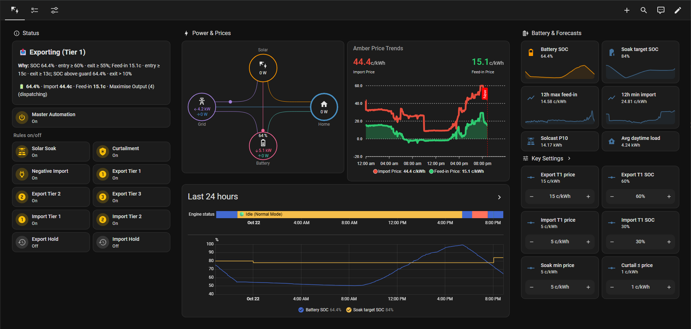
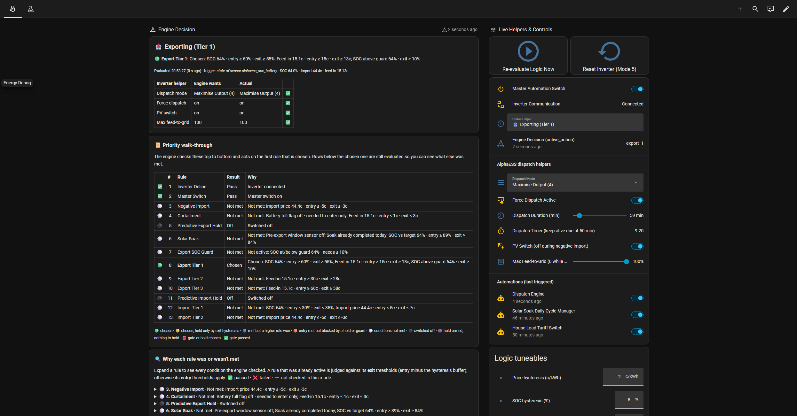

# HA Simple Energy Control

A Home Assistant package that runs an AlphaESS home battery against Amber Electric's wholesale prices. It charges from the grid when power is cheap or negative, exports when prices spike, makes room in the battery before a negative-price solar day, and stops exporting when feed-in goes negative. Solcast solar forecasts drive the solar-day planning.

It is set up for AlphaESS (local Modbus) and Amber Electric, but the logic is plain Home Assistant YAML and can be adapted to other batteries and retailers.



## Features

* **Tiered export and import rules.** Up to three export tiers and two import tiers, each with its own SOC and price threshold. For example: export at 20c/kWh when the battery is above 80%, but only at 100c/kWh when it is above 30%.
* **Predictive solar soak.** When Solcast forecasts more solar than the house will use, the battery is pre-exported overnight or early morning, in the best-paying window, down to a calculated target SOC. That leaves room to soak up the midday solar instead of exporting it at a negative price.
* **Negative feed-in curtailment.** When the battery is full and feed-in drops to or below your threshold, exports are stopped (grid export limit set to 0) until the price recovers.
* **Negative import price.** When the import price drops to or below your threshold, PV is switched off and the inverter draws from the grid (Mode 7), so you are paid to consume.
* **Grid charging.** When import is cheap and the battery is low, the battery force-charges from the grid at full power (Mode 6).
* **Predictive holds.** Looks 12 hours ahead in Amber's forecast and holds off exporting (or charging) when a clearly better price is coming, unless the live price is already extreme.
* **Hysteresis and safeguards.** Separate price and SOC buffers stop the system flapping near a threshold, and an export SOC guard sets a hard floor for discharging.
* **Explains every decision.** Each engine run publishes `sensor.amber_engine_decision`, which records what was chosen, the values used, and for every rule whether it was chosen, held by hysteresis, outranked, blocked or not met, with each condition it checked.
* **Notifications.** One push notification per state change, with the relevant price and SOC.
* **Dashboards.** A daily-use dashboard and a diagnostics dashboard (see [Dashboards](#dashboards)).

---

## Prerequisites

### Integrations

1. **[Amber Express](https://github.com/hass-energy/amber-express) (v2.0 or later)**, installed from HACS as a custom repository (type: Integration) and configured with your Amber API token.

   > This package needs **Amber Express**, not the built-in Amber Electric integration. Amber Express provides the forecast attributes the predictive features use.

   Provides `sensor.amber_express_<sitename>_general_price` (import) and `sensor.amber_express_<sitename>_feed_in_price` (feed-in).

2. **[Solcast Solar](https://github.com/BJReplay/ha-solcast-solar)** from HACS. The package reads the conservative P10 forecast (`estimate10` / `pv_estimate10`) from `sensor.solcast_pv_forecast_forecast_today` before 16:00 and `sensor.solcast_pv_forecast_forecast_tomorrow` from 16:00, falling back to the remaining-today sensor.

3. **[AlphaESS Modbus](https://projects.hillviewlodge.ie/alphaess/)** (hillviewlodge.ie), with the inverter set up for local Modbus TCP control. The package uses these entities from it:
   - `sensor.alphaess_soc_battery`, `sensor.alphaess_battery_full`, `sensor.alphaess_inverter_work_mode`
   - `input_select.alphaess_helper_dispatch_mode`, `input_number.alphaess_helper_dispatch_duration`, `input_boolean.alphaess_helper_dispatch`, `timer.alphaess_helper_dispatch_timer`
   - `input_boolean.alphaess_helper_dispatch_pv_switch` (turned off during negative import)
   - `input_number.alphaess_helper_max_feed_to_grid` (set to 0 during curtailment)
   - `input_button.alphaess_helper_dispatch_reset_full`

4. **A home energy monitor** such as a Shelly EM: `sensor.shelly_ct1_energy` (kWh, for the 7-day daytime load average) and `sensor.shelly_ct1_power` (W, for the dashboard).

5. **The Mobile App integration**, for `notify.mobile_app_<devicename>`.

### Dashboard cards (HACS)

* [`power-flow-card-plus`](https://github.com/flixlix/power-flow-card-plus)
* [`apexcharts-card`](https://github.com/RomRider/apexcharts-card)

---

## Installation

The whole thing is one [Home Assistant package](https://www.home-assistant.io/docs/configuration/packages/) file. No custom integration or Python is needed.

### 1. Enable packages (once)

Add this to `configuration.yaml` if you haven't already:

```yaml
homeassistant:
  packages: !include_dir_named packages
```

> **Already using packages?** Add this one by name instead:
> ```yaml
> homeassistant:
>   packages:
>     ha_simple_energy_control: !include packages/ha_simple_energy_control.yaml
> ```

### 2. Copy the package

Copy [`packages/ha_simple_energy_control.yaml`](packages/ha_simple_energy_control.yaml) into the `packages/` folder of your Home Assistant config directory.

### 3. Set your entity names

The **USER CONFIGURATION** block at the top of the file lists every external entity and service. Entity IDs are written out in full throughout the file, so if yours differ, find-and-replace them across the whole file (and the dashboards). The ones most likely to differ:

| What | Default | Where to find yours |
|---|---|---|
| Import price | `sensor.amber_express_home_general_price` | Settings → Devices & Services → Amber Express |
| Feed-in price | `sensor.amber_express_home_feed_in_price` | Settings → Devices & Services → Amber Express |
| Solcast forecast | `sensor.solcast_pv_forecast_forecast_today` / `_tomorrow` | Settings → Devices & Services → Solcast Solar |
| House energy / power | `sensor.shelly_ct1_energy` / `sensor.shelly_ct1_power` | Your energy monitor |
| Notifications | `notify.mobile_app_phone` | Settings → Devices & Services → Mobile App |

The AlphaESS entities listed under Prerequisites only need changing if your integration names them differently.

### 4. Restart Home Assistant

**Settings → System → Restart.** All helpers, sensors and automations are created on restart.

### 5. Add the dashboards

Each file is a complete dashboard and goes at the **root** of a dashboard, not inside a view.

1. **Settings → Dashboards → Add Dashboard**, name it (e.g. *Energy Management*) and open it.
2. Edit (pencil) → ⋮ → **Raw configuration editor**.
3. Replace everything with the contents of [`dashboard.yaml`](dashboard.yaml) and save.
4. Repeat with [`debug_dashboard.yaml`](debug_dashboard.yaml) for a second dashboard (e.g. *Energy Diagnostics*).
5. On the diagnostics dashboard, press **Re-evaluate Logic Now** once so the decision sensor has its first value (otherwise it fills in within 15 minutes).

To add the views to an existing dashboard instead, paste the entries under `views:` into that dashboard's `views:` list.

### Updating

Replace the package file and restart, then replace both dashboards' contents the same way. Check [CHANGELOG.md](CHANGELOG.md) for anything that needs attention.

---

## Dashboards

### Energy Management (`dashboard.yaml`)

* **Overview** shows the current status and *why*, quick on/off tiles for every rule, live power flow, Amber prices, a 24-hour history of what the engine did against battery SOC, forecast tiles, and the most-used thresholds with +/- buttons.
* **Rules** shows each rule group with its live result (coloured dot and a one-line reason), its toggle and its thresholds together.
* **Tuning** holds the solar soak model, hysteresis and safeguards, and manual inverter control.

### Energy Diagnostics (`debug_dashboard.yaml`)



* **Engine Decision** shows the last decision, when and why it ran, and warnings if the decision is stale, inputs changed without a re-run, the status helper disagrees, or the inverter helpers don't match what the engine asked for.
* **Priority walk-through** lists every rule in the order the engine checks them, with its result and reason.
* **Why each rule was or wasn't met** expands each rule into every condition it checked, showing the actual value against the entry and exit thresholds.
* **Solar Soak Inspector** shows how the frozen target SOC was calculated, and what it would be if recalculated now.
* **Scenario Simulator** has step-by-step recipes for forcing each mode to test it.

Rule results use these markers:

| | Meaning |
|:-:|---|
| 🟢 | Chosen |
| 🟡 | Chosen, but only held by its exit hysteresis (entry is no longer met) |
| 🔵 | Conditions met, but a higher-priority rule won |
| 🟠 | Entry met, but blocked by a predictive hold or the SOC guard |
| ⚪ | Conditions not met |
| ⚫ | Switched off |
| 🟣 | Hold armed, but nothing to hold |

---

## How it decides

The engine re-evaluates on every price, SOC or forecast change, whenever a setting changes, and every 15 minutes. It checks rules in this order and acts on the first that applies:

1. Inverter offline: do nothing until communication returns
2. Master switch off: return to Normal and stop
3. Negative import price
4. Negative feed-in curtailment
5. Predictive export hold
6. Solar soak pre-export
7. Export SOC guard
8. Export tiers 1, 2, 3
9. Predictive import hold
10. Import tiers 1, 2
11. Otherwise: Normal self-consumption

**Hysteresis.** A rule turns on as soon as its threshold is crossed, but once active it stays on until the value moves past the threshold by the buffer. With a 3c price buffer, an export tier set at 40c starts at 40c and stops below 37c. The SOC buffer works the same way for SOC thresholds.

### Solar soak

1. At 00:01, 06:00 and 16:05 (and whenever a soak setting changes), the package works out a **soak target SOC**: the solar it expects to reach the battery (Solcast P10 × your forecast weight, minus your 7-day average daytime house load) is converted to battery percentage and subtracted from your maximum target SOC, within your minimum floor.
2. If the battery is above that target, it looks for the best-paying window to discharge in before 10:30, or before feed-in is forecast to drop to your curtailment price if that is earlier, allowing enough time at your inverter's power.
3. In that window, and only while feed-in is at or above your minimum pre-export price, it discharges at Maximise Output (Mode 4) until the target is reached, then marks soak as done for the day.

### Curtailment

When the battery is full and feed-in is at or below your curtailment price, the grid export limit is set to 0 and the inverter stays in Normal mode, so solar still covers the house and tops up the battery. Curtailment continues (even if the battery-full flag flickers) until feed-in rises above the threshold plus the price buffer, then the export limit returns to 100%.

### Negative import

When import is at or below your negative-import price, PV is switched off and the inverter charges from the grid at Maximise Consumption (Mode 7). PV is switched back on when the price recovers.

### Predictive holds

An export hold applies when the 12-hour forecast maximum is at or above your hold threshold **and** higher than the live price plus the price buffer, so a spike that is already happening is not held back waiting for itself. A live price above your release level always overrides it. The import hold works the same way for forecast lows. Holds only show as active when a rule they guard would otherwise have acted.

### Dispatch keep-alive

Every forced dispatch is sent with a 60-minute duration on the inverter as a failsafe. While the same mode is still wanted, the engine refreshes it after 50 minutes (and in any case once fewer than 5 minutes remain), and it writes nothing to the inverter while nothing has changed.

### Manual control

Turn the **Master Automation** switch off, then use **Tuning → Manual Inverter Control** to pick a dispatch mode yourself. **Reset to Normal Mode** returns the inverter to self-consumption. While the master switch is on, the engine overwrites manual changes on its next run.

---

## Dispatch modes

For AlphaESS batteries on the hillviewlodge.ie integration:

| Mode | Name | Used for |
|---|---|---|
| 4 | Maximise Output | Discharging to the grid: export tiers and solar soak |
| 5 | Normal | Self-consumption: idle, holds, curtailment and resets |
| 6 | Optimise Consumption | Charging from the grid at full power, PV still contributing: import tiers |
| 7 | Maximise Consumption | Charging from the grid with PV switched off: negative import |

---

## License

[MIT](LICENSE)
